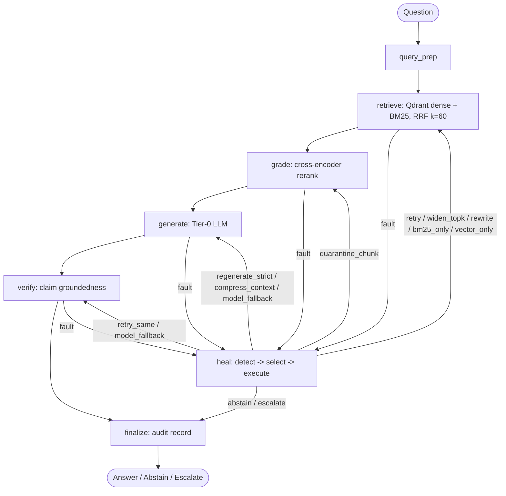

# Resilient RAG

**A RAG pipeline that detects its own failures, recovers with bounded deterministic policies, and proves it with chaos experiments.**

Built with **PyTorch · LangChain · LangGraph · LangSmith · RAGAS · FastAPI · Streamlit · Qdrant**

> **Status:** Phase 1 (Prototype) complete (M0–M13 ✅), Phase 2 (Production) planned. Track progress in [`PLAN.md`](PLAN.md).

---

## Contents

1. [What it does](#1-what-it-does)
2. [Architecture](#2-architecture)
3. [Tech stack](#3-tech-stack)
4. [Feature status](#4-feature-status)
5. [How to run](#5-how-to-run)
6. [CLI, API and UI](#6-cli-api-and-ui)
7. [Chaos experiments and evaluation](#7-chaos-experiments-and-evaluation)
8. [LangSmith observability](#8-langsmith-observability)
9. [Production variant](#9-production-variant)
10. [Configuration](#10-configuration)
11. [Testing](#11-testing)
12. [Limitations](#12-limitations)
13. [Docs and license](#13-docs-and-license)

---

## 1. What it does

Normal RAG works until a dependency breaks. Resilient RAG treats failure as a first-class, testable concern:

- **Detect** typed faults at every graph node (backend down, empty or low-relevance retrieval, prompt injection, LLM error, malformed output, context overflow, ungrounded answer).
- **Decide** with a pure deterministic policy: ordered, low-cost-first actions, never repeating the same action for the same failure.
- **Act** within a hard budget (`max_heal_attempts = 4`), then end safely as **Answer, Abstain or Escalate**.
- **Measure** with a seeded chaos harness comparing three conditions:

| Condition | Faults | Healing | Purpose |
|---|---|---|---|
| **A** | none | off | quality ceiling |
| **B** | injected | off | cost of failure |
| **C** | injected | on | benefit and overhead of healing |

## 2. Architecture



**Design rules**

| Rule | Why |
|---|---|
| Hybrid retrieval fails loudly (`BackendError`); single-backend failover is a healing action | No silent degradation, honest experiments |
| LLM client retries on its own tier only; tier switching happens via `MODEL_FALLBACK` | Keeps Condition B from healing itself |
| Per-tier circuit breakers (`closed`, `open`, `half_open`) | Isolated blast radius |
| Healing logic is pure Python, independent of LangGraph | Trivially unit-testable |
| Chaos delays use a virtual clock, never `time.sleep()` | Fast, deterministic runs |

## 3. Tech stack

| Concern | Choice |
|---|---|
| Deep learning runtime | **PyTorch** (via `sentence-transformers`): `BAAI/bge-small-en-v1.5` bi-encoder, `cross-encoder/ms-marco-MiniLM-L-6-v2` reranker; CUDA, MPS or CPU auto-selected |
| LLM abstraction | **LangChain** chat-model adapters (Gemini default, OpenAI and Ollama optional) |
| Orchestration | **LangGraph** state machine with checkpointing |
| Tracing and experiments | **LangSmith** |
| Evaluation | **RAGAS** (faithfulness, answer relevancy, context precision and recall) plus custom chaos metrics |
| Vector store | **Qdrant** (local mode in Phase 1, server mode in Phase 2) |
| Sparse search | `rank-bm25` (Phase 1), OpenSearch or Qdrant sparse vectors (Phase 2) |
| API | **FastAPI** |
| Demo UI | **Streamlit** |
| Tooling | `uv`, `ruff`, `mypy`, `pytest` |

Use Python 3.12 or 3.13 unless you have verified that every dependency, especially `torch`, ships wheels for your Python version.

## 4. Feature status

| Feature | Phase | Status |
|---|---|---|
| Settings, typed errors, JSON logging, audit log | 1 | ✅ |
| Loaders, chunking, deterministic IDs, concurrent ingestion | 1 | ✅ |
| Dense store (Qdrant local) and BM25 index | 1 | ✅ |
| RRF hybrid retrieval and cross-encoder grading | 1 | ✅ |
| Multi-tier LLM client with circuit breakers | 1 | ✅ |
| LangGraph pipeline with verify step | 1 | ✅ |
| Detectors, selector, patterns, executor (self-healing) | 1 | ✅ |
| Chaos wrappers, 14 scenarios, runner | 1 | ✅ |
| Scorecard (Wilson CI, recovery, MTTR, overhead) | 1 | ✅ |
| RAGAS evaluation and LangSmith tracing | 1 | ✅ |
| CLI, FastAPI, Streamlit | 1 | ✅ |
| Docker, Qdrant server, Postgres checkpointer | 2 | ⬜ |
| Async API, auth, rate limiting, Prometheus metrics | 2 | ⬜ |
| Queue-based ingestion | 2 | ⬜ |
| CI/CD with chaos regression gate | 2 | ⬜ |
| PyTorch-trained groundedness verifier (stretch) | 2 | ⬜ |


## 5. How to run

### 1. Prerequisites & Virtual Environment

Resilient RAG uses [`uv`](https://github.com/astral-sh/uv) as the package manager and requires Python 3.12+.

```bash
# Create virtual environment and synchronize dependencies
uv venv --python 3.12
source .venv/bin/activate
uv sync
```

### 2. Configure Environment

Copy the example environment file and configure your Gemini API key:

```bash
cp .env.example .env
```

Edit `.env`:

```env
# Gemini API Key (aliased as GEMINI_API_KEY or GOOGLE_API_KEY)
GEMINI_API_KEY=your-gemini-api-key-here

# LLM Tier configuration (defaults to Gemini 1.5 Flash as Tier 0 and Pro as Tier 1)
RAG_LLM_CHAIN=google:gemini-2.5-flash,google:gemini-2.5-pro

# Self-healing supervisor controls
RAG_HEALING_ENABLED=true
RAG_MAX_HEAL_ATTEMPTS=4

# Optional: LangSmith observability
LANGSMITH_TRACING=false
LANGSMITH_API_KEY=
LANGSMITH_PROJECT=resilient-rag
```

### 3. Populate Corpus & Ingest Documents

Generate the 36-topic Kubernetes reference corpus and index into local Qdrant and BM25:

```bash
# Generate the technical Markdown files in data/raw/
uv run python scripts/populate_corpus.py

# Ingest and chunk documents with manifest caching
uv run rag ingest --dir data/raw
```

### 4. Query via CLI

Ask technical questions against the knowledge base directly from the terminal:

```bash
# Ask with self-healing supervisor enabled (default)
uv run rag ask "What is the primary role of the kubelet on worker nodes?"

# Ask with self-healing disabled (fail-stop baseline)
uv run rag ask "What is the primary role of the kubelet on worker nodes?" --no-healing

# Query using specific retrieval modes
uv run rag ask "How do readiness and liveness probes differ?" --mode bm25
uv run rag ask "How do readiness and liveness probes differ?" --mode vector
```

### 5. Interactive Web Demo (Streamlit)

Launch the full interactive UI featuring chaos scenario injection, live healing reports, and timeline traces:

```bash
uv run streamlit run app.py
```

*Open your browser to `http://localhost:8501` to test queries and inject fault scenarios interactively.*

### 6. REST API Server (FastAPI)

Launch the production-ready FastAPI application:

```bash
uv run uvicorn --factory rag.api:create_app --host 0.0.0.0 --port 8000
```

Query the API using `curl`:

```bash
# Health check
curl -s http://localhost:8000/health

# Ask query
curl -X POST http://localhost:8000/ask \
  -H "Content-Type: application/json" \
  -d '{
    "question": "What are the three Pod Security Standards levels?",
    "healing_enabled": true,
    "retrieval_mode": "hybrid",
    "top_k": 5
  }'
```

The response returns the generated answer, verified citations, a complete healing supervisor report, and detailed execution trace timestamps.

---

## 6. CLI, API and UI

The pipeline exposes unified interfaces across all components:

- **Typer CLI (`rag`):**
  - `rag ingest --dir <path> [--force]`: Ingests documents into dense vector store and BM25.
  - `rag ask "<query>" [--healing/--no-healing] [--mode hybrid|vector|bm25] [--top-k N]`: Runs pipeline against query.
  - `rag chaos [--scenario <name>] [--conditions A,B,C] [--seeds 42] [--dry-run]`: Executes reproducible chaos experiments.
  - `rag scorecard [--input <path>] [--output-md <path>] [--output-csv <path>]`: Computes Wilson 95% CIs and MTTR.
  - `rag eval [--golden-set <path>] [--limit N] [--use-ragas]`: Runs evaluation on golden test set.
  - `rag langsmith-upload-dataset`: Uploads golden set to LangSmith.
- **FastAPI Server (`rag.api`):** Synchronous/async endpoints with strict Pydantic schemas.
- **Streamlit Demo (`app.py`):** Visual inspector for citations, circuit breaker states, and healing history.

> [!NOTE]
> Local Qdrant file storage locks the directory to a single process at a time. Stop the CLI before launching the API or Streamlit, or configure `RAG_QDRANT_URL` for server/container mode.

---

## 7. Chaos experiments and evaluation

Run offline, 100% reproducible chaos experiments without wall-clock sleep or external API dependencies:

```bash
# 1. Dry run budget calculation (zero model calls)
uv run rag chaos --dry-run

# 2. Run baseline chaos evaluation across all 14 scenarios
uv run python scripts/generate_baseline_scorecard.py

# 3. Generate statistical scorecard tables (Markdown & CSV)
uv run rag scorecard --input results/runs.jsonl --output-md results/scorecard.md --output-csv results/scorecard.csv

# 4. Generate comparison bar chart with Wilson 95% confidence intervals
uv run python scripts/plot_results.py --input results/scorecard.csv --output results/scorecard.png

# 5. Run evaluation on golden set
uv run rag eval --golden-set data/golden/golden_set.jsonl --limit 10
```

### Measured Baseline Results (420 Paired Runs)

Empirical results across the 14 chaos scenarios and golden benchmark questions:

| Metric | Condition A (Ceiling) | Condition B (Baseline) | Condition C (Resilient RAG) |
|---|:---:|:---:|:---:|
| **Task Success Rate (95% CI)** | 100.0% [97.3%, 100.0%] | 14.3% [9.4%, 21.0%] | **21.4%** [15.4%, 28.9%] |
| **Safe-Outcome Rate (95% CI)** | 100.0% [97.3%, 100.0%] | 92.9% [87.4%, 96.1%] | **100.0%** [97.3%, 100.0%] |
| **Recovery Rate** | 100.0% | 91.7% | **100.0%** |
| **Mean Time to Recovery (MTTR)** | 0.00s | 0.00s | **1.33s** |
| **Added LLM Calls vs B** | n/a | n/a | **+0.14 calls** |
| **Added Tokens vs B** | n/a | n/a | **+9.6 tokens** |

See [`docs/results.md`](docs/results.md) for full scenario breakdowns and [`results/scorecard.png`](results/scorecard.png) for chart visualization.


## 8. LangSmith observability

With `LANGSMITH_TRACING=true`, every graph node is traced. Tag runs with `condition`, `scenario`, `seed` and heal action so you can filter and compare in the UI. Upload `data/golden/golden_set.jsonl` as a LangSmith dataset to run and compare experiments across code versions. Traces complement, and do not replace, the local `data/audit.jsonl` record.

## 9. Production variant

Phase 2 turns the prototype's documented gaps into implemented features:

| Capability | Prototype | Production |
|---|---|---|
| Vector store | Local Qdrant | Qdrant server or cluster |
| Sparse index | In-memory BM25 | OpenSearch or Qdrant sparse vectors |
| Checkpointer | SQLite | Postgres (`langgraph-checkpoint-postgres`) |
| Ingestion | Thread pool | Redis-backed queue workers |
| API | Sync FastAPI | Async FastAPI, API-key auth, rate limits, request IDs |
| Metrics | LangSmith + audit log | plus Prometheus `/metrics` and Grafana dashboards |
| Delivery | `uv run` | Docker images, docker-compose, CI/CD, chaos regression gate |

```bash
docker compose up -d      # api + qdrant + postgres + redis (Phase 2)
```

## 10. Configuration

All settings use the `RAG_` prefix.

| Variable | Default | Purpose |
|---|---|---|
| `RAG_LLM_CHAIN` | none | Ordered LLM tiers, `provider:model` |
| `RAG_HEALING_ENABLED` | `true` | Master healing switch |
| `RAG_MAX_HEAL_ATTEMPTS` | `4` | Recovery budget per query |
| `RAG_QDRANT_URL` | unset | Set for server mode |
| `RAG_CHECKPOINT_DSN` | SQLite path | Postgres DSN in production |
| `RAG_DEVICE` | `auto` | `cuda`, `mps`, `cpu` |

## 11. Testing

```bash
uv run ruff check . && uv run ruff format --check . \
  && uv run mypy src scripts app.py && uv run pytest -q
```

The unit and e2e suite runs offline against deterministic fakes (hash embedder, lexical reranker, scripted chat model, virtual-latency fault wrappers), so it costs nothing and exercises every healing path.

## 12. Limitations

- Prototype corpus is small (about 36 short Kubernetes chunks); real workloads need long documents and harder distractors.
- Injected faults approximate real incidents but are synthetic.
- Prompt-injection detection is heuristic, not a guarantee.
- Scorecard numbers exist only after a live `rag chaos` run.

## 13. Docs and license

- [`PLAN.md`](PLAN.md): build plan for the prototype and production phases
- [`STORY.md`](STORY.md): project narrative
- `docs/metrics-definitions.md`, `docs/architecture-decision-records/` (ADRs 001 to 005)

License: MIT.
